<!-- Generated by scripts/render_readme.py from data/card-manifest.json. -->

<a href="https://takneekitanmay.tech">
<picture>
  <source media="(prefers-color-scheme: dark) and (max-width: 600px)" srcset="./cards/dark/hero-mobile.svg" />
  <source media="(max-width: 600px)" srcset="./cards/light/hero-mobile.svg" />
  <source media="(prefers-color-scheme: dark)" srcset="./cards/dark/hero.svg" />
  
</picture>
</a>

<picture>
  <source media="(prefers-color-scheme: dark) and (max-width: 600px)" srcset="./cards/dark/connect-mobile.svg" />
  <source media="(max-width: 600px)" srcset="./cards/light/connect-mobile.svg" />
  <source media="(prefers-color-scheme: dark)" srcset="./cards/dark/connect.svg" />
  
</picture>

<a href="https://takneekitanmay.tech">
<picture>
  <source media="(prefers-color-scheme: dark) and (max-width: 600px)" srcset="./cards/dark/social-portfolio-mobile.svg" />
  <source media="(max-width: 600px)" srcset="./cards/light/social-portfolio-mobile.svg" />
  <source media="(prefers-color-scheme: dark)" srcset="./cards/dark/social-portfolio.svg" />
  
</picture>
</a>

<a href="https://www.linkedin.com/in/tanmay-tiwari20/">
<picture>
  <source media="(prefers-color-scheme: dark)" srcset="./cards/dark/social-linkedin.svg" />
  
</picture>
</a>
<a href="https://www.instagram.com/takneekitanmay/">
<picture>
  <source media="(prefers-color-scheme: dark)" srcset="./cards/dark/social-instagram.svg" />
  
</picture>
</a>

<a href="https://github.com/tanmay-tiwari-20">
<picture>
  <source media="(prefers-color-scheme: dark)" srcset="./cards/dark/social-github.svg" />
  
</picture>
</a>
<a href="mailto:workwithtakneekitanmay@gmail.com">
<picture>
  <source media="(prefers-color-scheme: dark)" srcset="./cards/dark/social-email.svg" />
  
</picture>
</a>

<picture>
  <source media="(prefers-color-scheme: dark) and (max-width: 600px)" srcset="./cards/dark/repositories-mobile.svg" />
  <source media="(max-width: 600px)" srcset="./cards/light/repositories-mobile.svg" />
  <source media="(prefers-color-scheme: dark)" srcset="./cards/dark/repositories.svg" />
  
</picture>

<picture>
  <source media="(prefers-color-scheme: dark) and (max-width: 600px)" srcset="./cards/dark/languages-mobile.svg" />
  <source media="(max-width: 600px)" srcset="./cards/light/languages-mobile.svg" />
  <source media="(prefers-color-scheme: dark)" srcset="./cards/dark/languages.svg" />
  
</picture>

<picture>
  <source media="(prefers-color-scheme: dark) and (max-width: 600px)" srcset="./cards/dark/skills-01-mobile.svg" />
  <source media="(max-width: 600px)" srcset="./cards/light/skills-01-mobile.svg" />
  <source media="(prefers-color-scheme: dark)" srcset="./cards/dark/skills-01.svg" />
  
</picture>

<picture>
  <source media="(prefers-color-scheme: dark) and (max-width: 600px)" srcset="./cards/dark/skills-02-mobile.svg" />
  <source media="(max-width: 600px)" srcset="./cards/light/skills-02-mobile.svg" />
  <source media="(prefers-color-scheme: dark)" srcset="./cards/dark/skills-02.svg" />
  
</picture>

<picture>
  <source media="(prefers-color-scheme: dark) and (max-width: 600px)" srcset="./cards/dark/skills-03-mobile.svg" />
  <source media="(max-width: 600px)" srcset="./cards/light/skills-03-mobile.svg" />
  <source media="(prefers-color-scheme: dark)" srcset="./cards/dark/skills-03.svg" />
  
</picture>

<picture>
  <source media="(prefers-color-scheme: dark) and (max-width: 600px)" srcset="./cards/dark/skills-04-mobile.svg" />
  <source media="(max-width: 600px)" srcset="./cards/light/skills-04-mobile.svg" />
  <source media="(prefers-color-scheme: dark)" srcset="./cards/dark/skills-04.svg" />
  
</picture>

<picture>
  <source media="(prefers-color-scheme: dark) and (max-width: 600px)" srcset="./cards/dark/skills-05-mobile.svg" />
  <source media="(max-width: 600px)" srcset="./cards/light/skills-05-mobile.svg" />
  <source media="(prefers-color-scheme: dark)" srcset="./cards/dark/skills-05.svg" />
  
</picture>

<picture>
  <source media="(prefers-color-scheme: dark) and (max-width: 600px)" srcset="./cards/dark/skills-06-mobile.svg" />
  <source media="(max-width: 600px)" srcset="./cards/light/skills-06-mobile.svg" />
  <source media="(prefers-color-scheme: dark)" srcset="./cards/dark/skills-06.svg" />
  
</picture>

<picture>
  <source media="(prefers-color-scheme: dark) and (max-width: 600px)" srcset="./cards/dark/skills-07-mobile.svg" />
  <source media="(max-width: 600px)" srcset="./cards/light/skills-07-mobile.svg" />
  <source media="(prefers-color-scheme: dark)" srcset="./cards/dark/skills-07.svg" />
  
</picture>

<picture>
  <source media="(prefers-color-scheme: dark) and (max-width: 600px)" srcset="./cards/dark/skills-08-mobile.svg" />
  <source media="(max-width: 600px)" srcset="./cards/light/skills-08-mobile.svg" />
  <source media="(prefers-color-scheme: dark)" srcset="./cards/dark/skills-08.svg" />
  
</picture>

<picture>
  <source media="(prefers-color-scheme: dark) and (max-width: 600px)" srcset="./cards/dark/project-network-mobile.svg" />
  <source media="(max-width: 600px)" srcset="./cards/light/project-network-mobile.svg" />
  <source media="(prefers-color-scheme: dark)" srcset="./cards/dark/project-network.svg" />
  
</picture>

<a href="https://github.com/tanmay-tiwari-20/Unoverse">Unoverse</a> · <a href="https://github.com/tanmay-tiwari-20/Spools">Spools</a> · <a href="https://github.com/tanmay-tiwari-20/Baithak">Baithak</a> · <a href="https://github.com/tanmay-tiwari-20/Resumify">Resumify</a>

<picture>
  <source media="(prefers-color-scheme: dark) and (max-width: 600px)" srcset="./cards/dark/heatmap-mobile.svg" />
  <source media="(max-width: 600px)" srcset="./cards/light/heatmap-mobile.svg" />
  <source media="(prefers-color-scheme: dark)" srcset="./cards/dark/heatmap.svg" />
  
</picture>

<picture>
  <source media="(prefers-color-scheme: dark) and (max-width: 600px)" srcset="./cards/dark/activity-mobile.svg" />
  <source media="(max-width: 600px)" srcset="./cards/light/activity-mobile.svg" />
  <source media="(prefers-color-scheme: dark)" srcset="./cards/dark/activity.svg" />
  
</picture>

<a href="mailto:workwithtakneekitanmay@gmail.com">
<picture>
  <source media="(prefers-color-scheme: dark) and (max-width: 600px)" srcset="./cards/dark/footer-mobile.svg" />
  <source media="(max-width: 600px)" srcset="./cards/light/footer-mobile.svg" />
  <source media="(prefers-color-scheme: dark)" srcset="./cards/dark/footer.svg" />
  
</picture>
</a>

About me, projects, and links in plain text

I'm **Tanmay Tiwari**, a full-stack developer from India. I build web applications, interactive 3D experiences, and products that bring people together. I'm currently working on personal projects and open to full-stack collaborations. Ask me about hackathons.

### Projects

- [Unoverse](https://github.com/tanmay-tiwari-20/Unoverse): A 3D multiplayer UNO experience with custom rules, bots and voice chat. Built with Next.js, Three.js, Socket.IO.
- [Spools](https://github.com/tanmay-tiwari-20/Spools): Interest-based communities, shared stories and real-time conversations. Built with React, Express, MongoDB.
- [Baithak](https://github.com/tanmay-tiwari-20/Baithak): Video meetings with scheduling, personal rooms and host controls. Built with Next.js, TypeScript, Stream.
- [Resumify](https://github.com/tanmay-tiwari-20/Resumify): AI-powered resume reviews, ATS scoring and personalized feedback. Built with React, TypeScript, Puter.

### Toolkit

- **Frontend:** React, Next.js, TypeScript, JavaScript, Tailwind CSS.
- **Backend:** Node.js, Express, MongoDB, Redis, Socket.IO.
- **Creative web:** Three.js, React Three Fiber, GSAP, Framer Motion.
- **Tools:** Docker, npm, Vercel Analytics, Vite, ESLint.

### Find me

[Portfolio](https://takneekitanmay.tech) · [GitHub](https://github.com/tanmay-tiwari-20) · [LinkedIn](https://www.linkedin.com/in/tanmay-tiwari20/) · [Instagram](https://www.instagram.com/takneekitanmay/) · [X](https://x.com/TakneekiTanmay) · [Email](mailto:workwithtakneekitanmay@gmail.com)

The skill tiles show real tools found in my public projects. [Skill evidence and complete dependency inventory](./docs/TECHNOLOGIES.md) · [Profile maintenance](./docs/PROFILE.md).

