

<a href="https://takneekitanmay.tech">
  
</a>

  <a href="https://takneekitanmay.tech">Portfolio</a> ·
  <a href="https://www.linkedin.com/in/tanmay-tiwari20/">LinkedIn</a> ·
  <a href="mailto:workwithtakneekitanmay@gmail.com">Email</a> ·
  <a href="https://www.instagram.com/takneekitanmay/">Instagram</a>

  

  

  <a href="https://github.com/tanmay-tiwari-20?tab=repositories"></a>
  <a href="https://takneekitanmay.tech"></a>
  <a href="mailto:workwithtakneekitanmay@gmail.com"></a>

<h3>Selected projects</h3>

  <a href="https://github.com/tanmay-tiwari-20/Unoverse"></a>
  <a href="https://github.com/tanmay-tiwari-20/Spools"></a>

  <a href="https://github.com/tanmay-tiwari-20/Baithak"></a>
  <a href="https://github.com/tanmay-tiwari-20/Resumify"></a>

  

<a href="mailto:workwithtakneekitanmay@gmail.com">
  
</a>

About me, projects, and links in plain text

I'm **Tanmay Tiwari**, a full-stack developer from India. I build web applications, interactive 3D experiences, and products that bring people together. I'm currently working on personal projects and open to full-stack collaborations. Ask me about hackathons.

### Projects

- [Unoverse](https://github.com/tanmay-tiwari-20/Unoverse): a 3D multiplayer UNO experience with custom rules, bots, and voice chat. Built with Next.js, TypeScript, React Three Fiber, and Socket.IO.
- [Spools](https://github.com/tanmay-tiwari-20/Spools): a social platform with interest-based communities, collaborative stories, and real-time messaging. Built with React, Node.js, Express, and MongoDB.
- [Baithak](https://github.com/tanmay-tiwari-20/Baithak): video meetings with scheduling, personal rooms, and host-controlled access. Built with Next.js, TypeScript, Clerk, and Stream.
- [Resumify](https://github.com/tanmay-tiwari-20/Resumify): AI-powered resume reviews with ATS scoring and personalized feedback. Built with React, TypeScript, Tailwind CSS, and Puter.

### Toolkit

- **Frontend:** React, Next.js, TypeScript, JavaScript, Tailwind CSS.
- **Backend:** Node.js, Express, MongoDB, Redis, Socket.IO.
- **Creative web:** Three.js, React Three Fiber, GSAP, Framer Motion.
- **Tools:** Git, GitHub, Vercel, Vite, Figma.

### Find me

[Portfolio](https://takneekitanmay.tech) · [GitHub](https://github.com/tanmay-tiwari-20) · [LinkedIn](https://www.linkedin.com/in/tanmay-tiwari20/) · [Instagram](https://www.instagram.com/takneekitanmay/) · [Email](mailto:workwithtakneekitanmay@gmail.com)

The activity cards use my public GitHub contribution calendar. [How the cards are maintained](./docs/PROFILE.md).

Design inspired by [Avi Vashishta's animated SVG README cards](https://www.avivashishta.com/blog/github-profile-readme-animated-svg-cards).

